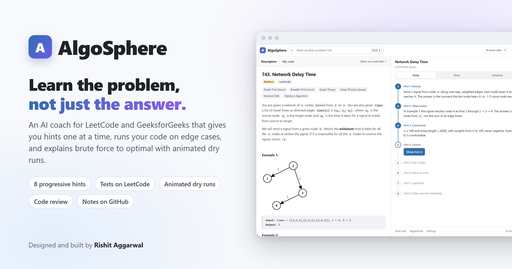
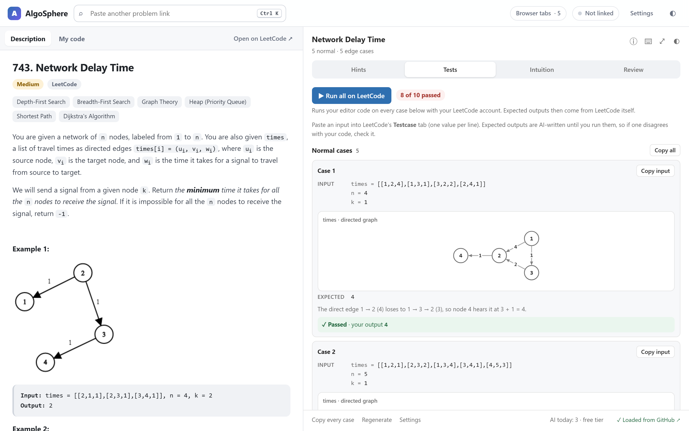
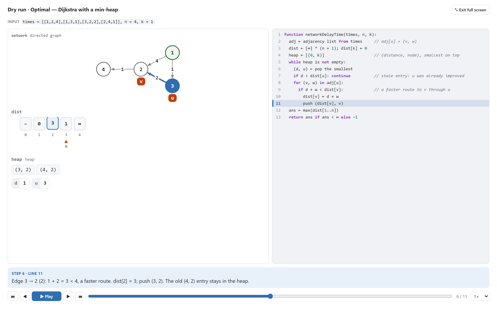
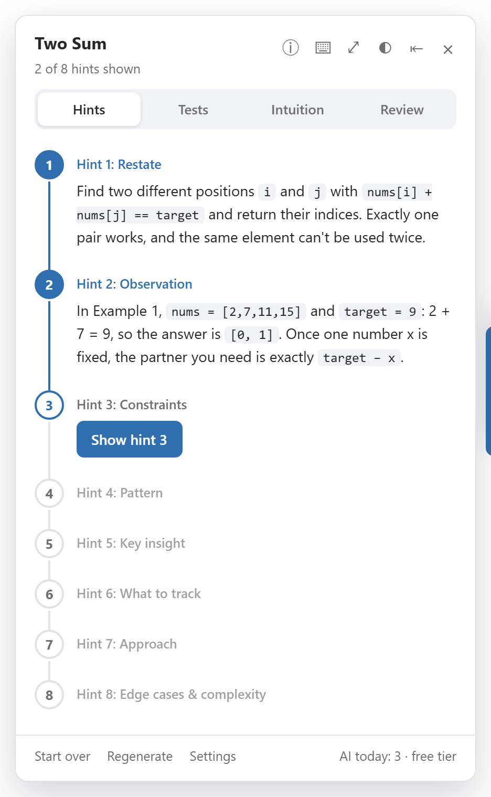

# AlgoSphere

**Learn the problem, not just the answer.** AlgoSphere is a free Chrome and Edge extension that coaches you through LeetCode and GeeksforGeeks problems instead of solving them for you: hints one at a time, edge-case tests you run with your own code, brute force to optimal with animated dry runs, a review of your approach and code, and notes saved to your own GitHub.

**[⬇ Download AlgoSphere v4.6.0](https://rishitaggarwal1.github.io/algosphere-app/AlgoSphere-latest.zip)** · **[Website](https://rishitaggarwal1.github.io/algosphere-app/)** · **[Privacy policy](https://rishitaggarwal1.github.io/algosphere-app/privacy.html)** · **[How it's built (12-slide PDF)](https://rishitaggarwal1.github.io/algosphere-app/algosphere-architecture-carousel.pdf)**



This repository holds the download page and the packaged extension. Nothing in it needs to be built: download the zip and load it in your browser.

---

## Contents

- [What it does](#what-it-does)
- [Install](#install)
- [First-time setup: your AI key](#first-time-setup-your-ai-key)
- [Using AlgoSphere](#using-algosphere)
- [Keyboard shortcuts](#keyboard-shortcuts)
- [Save your notes to GitHub](#save-your-notes-to-github)
- [Speed, reliability and cost](#speed-reliability-and-cost)
- [Updating and uninstalling](#updating-and-uninstalling)
- [Privacy](#privacy)
- [Troubleshooting](#troubleshooting)
- [What's in this repository](#whats-in-this-repository)
- [Credits and license](#credits-and-license)

---

## What it does

| | |
|---|---|
| 💡 **8 progressive hints** | From "what is this really asking?" to edge cases and complexity. Each hint gives away a little more, and none of them contain code. |
| 🧪 **Tests you actually run** | 5 normal and 5–7 edge cases, plus your own. One click runs them all on LeetCode or GeeksforGeeks with your code and your signed-in account; the site's judge supplies the expected outputs. |
| 🧠 **Brute force → better → optimal** | The clues hidden in the statement, what the constraints allow, an expert's train of thought as questions, and three approaches with a line-by-line complexity breakdown. |
| 🎬 **Animated dry runs** | Step through each approach on a real input: arrays with pointers, stacks, queues, heaps, trees, linked lists and graphs, next to the highlighted pseudocode. Full-screen mode included. |
| 💻 **C++ code** | Every approach as a LeetCode-ready solution and as a full program with `main()`. |
| 🔍 **Review** | *Check my approach* tells you whether a plan will work before you code. *Review my code* reads your editor and points to the exact lines that go wrong, with a nudge instead of a rewrite. |
| ✅ **Your solutions** | Accepted submissions are saved automatically, with runtime, memory and the hints you used. |
| 📦 **Notes on GitHub** | Optional: every problem saved to a repository you own as a readable README plus a compilable `.cpp` file, one commit per save. |

Works on `leetcode.com`, `leetcode.cn` (everything except running tests) and `geeksforgeeks.org` problem pages, in Chrome 111+ and Microsoft Edge.

<p>
  
  
</p>

---

## Install

AlgoSphere isn't on the Chrome Web Store yet, so it's installed with **Load unpacked**. It takes about a minute.

1. **Download** [`AlgoSphere-latest.zip`](https://rishitaggarwal1.github.io/algosphere-app/AlgoSphere-latest.zip) and unzip it.
2. Move the unzipped **`AlgoSphere`** folder somewhere permanent, for example `Documents\AlgoSphere`. The browser loads the extension from this folder, so don't delete it.
3. Open the extensions page:
   - Chrome: `chrome://extensions`
   - Edge: `edge://extensions`
4. Turn on **Developer mode** (top-right in Chrome, left sidebar in Edge).
5. Click **Load unpacked** and choose the `AlgoSphere` folder (the one that contains `manifest.json`).
6. Optional: pin it. Click the puzzle-piece icon in the toolbar and pin **AlgoSphere** for quick access to its settings.

You're done. Open any problem, for example [Two Sum](https://leetcode.com/problems/two-sum/), and an **AlgoSphere** tab appears on the right edge of the page.

> The browser may show a "Disable developer mode extensions" notice when it starts. That's normal for extensions installed this way; click the × to keep AlgoSphere on.

---

## First-time setup: your AI key

AlgoSphere has no server and no account. It calls the AI provider you choose directly, with your own key, so you stay in control of cost and data.

**Gemini (recommended, has a free tier):**
1. Go to [Google AI Studio → API keys](https://aistudio.google.com/apikey), sign in with a Google account and click **Create API key**.
2. Click the AlgoSphere icon (or **Settings** in the panel) to open the settings page.
3. Keep **Google Gemini** selected, paste the key and click **Find models**. This picks the newest fast model your key can use.
4. Click **Test connection**, then **Save settings**.

**Claude or OpenAI:** choose the provider, paste a key from the [Claude Console](https://console.anthropic.com/) or the [OpenAI platform](https://platform.openai.com/api-keys), test and save.

**Better explanations (optional):** *Model for Intuition and Review* lets those two sections use a stronger model while hints and tests stay on the cheaper, faster one.

---

## Using AlgoSphere

Open a problem and click the **AlgoSphere** tab (or press `Alt+Shift+H`). The panel has four sections.

### Hints
Eight rungs, revealed one click at a time: **Restate · Observation · Constraints · Pattern · Key insight · What to track · Approach · Edge cases & complexity**. They're prepared as soon as the panel opens, so the first click is instant. Your progress is remembered per problem; **Start over** hides them again for revision.

### Tests
- **5 normal and 5–7 edge cases**, each with its input (in the site's own format), expected output and what it checks. Trees, linked lists and graphs are drawn under the case.
- **▶ Run all** runs your editor code on every case with your signed-in account. LeetCode cases go in batches; GeeksforGeeks cases go one at a time through its *Compile & Run* (Custom Input is restored afterwards). Each case shows **✓ Passed** or **✗ Failed** with your output next to the judge's.
- **Your cases:** click **＋ Add a case** to test any input you like. The form has a box per parameter, named from the problem; the expected output is optional because the judge fills it in. **▶ Run yours** runs only your cases; **Edit**, **Delete** and **Copy input** work per case.

### Intuition
The problem in one line, its pattern, the clues in the statement, what the constraints allow, *Think it through* questions with hidden answers, and three approaches. Each approach has an explanation, steps, pseudocode, a line-by-line complexity breakdown, an **animated dry run** (play, step, scrub, change speed, or go full screen) and **C++ code**.

### Review
- **Check my approach:** describe your plan before coding and get a verdict (*will work, too slow, won't work, incomplete*) with the reason, without the solution.
- **Review my code:** reads the code from the site's editor and gives a verdict (*correct, wrong answer, too slow, partially correct, incomplete, won't compile*), what's right, and each problem tied to its lines.

### Your accepted solutions
When a submission is accepted, AlgoSphere saves it with its runtime and memory, and shows "Solved" on the problem. With GitHub sync on, it's committed to your notes repository too.

<p align="center"></p>

---

## Keyboard shortcuts

On a problem page (use Option instead of Alt on a Mac):

| Keys | Action |
|---|---|
| `Alt+Shift+H` | Open or close the panel from anywhere (change it at `chrome://extensions/shortcuts`) |
| `Alt+H` | Open the panel, or show the next hint |
| `Alt+T` | Test cases |
| `Alt+U` | Run all test cases |
| `Alt+I` | Intuition |
| `Alt+P` | Check my approach |
| `Alt+R` | Review my code |
| `Alt+W` | Wider / narrower panel |
| `Alt+M` | Full-screen panel, hiding the problem (`Esc` to leave) |
| `Alt+/` | Show the shortcuts in the panel |
| `Esc` | Close the panel |

In a dry run: `Space` plays or pauses, `←` / `→` step, `Home` / `End` jump, `F` toggles full screen. Shortcuts can be turned off in Settings.

---

## Save your notes to GitHub

Optional, but it turns everything you study into a readable set of DSA notes, and lets you open a problem on another computer without calling the AI again.

1. Create a repository for your notes, for example `dsa-notes` (private is fine).
2. Create a [fine-grained token](https://github.com/settings/personal-access-tokens/new): under **Repository access** choose *Only select repositories* and pick that repository; under **Repository permissions** set **Contents** to *Read and write*.
3. In AlgoSphere's settings, under **Save to GitHub**: tick **Turn on GitHub sync**, enter the repository as `owner/repo`, paste the token, click **Test connection**, then **Save GitHub settings**.
4. Optional: **Upload saved problems** pushes everything already saved in this browser.

What you get:

```
dsa-notes/
├── README.md                 index of every problem: difficulty, pattern, complexity, links
├── leetcode/two-sum/
│   ├── README.md             the full lesson: hints (folded), intuition, approaches, tests, your cases
│   ├── two-sum.cpp           the best solution as a compilable program
│   ├── my-solution.cpp       your accepted solution
│   └── notes.json            the data AlgoSphere loads back
└── gfg/<problem>/…
```

Each save is a single commit, only changed sections are sent, and a copy on another computer can never overwrite newer notes. The footer of the panel shows the sync state; if GitHub has a bad moment, AlgoSphere retries by itself.

---

## Speed, reliability and cost

In **Settings → Speed & reliability**:
- **Response speed:** *Fast*, *Balanced* (recommended) or *Thorough*: how long the model thinks for each section.
- **Backup model** and **backup provider:** if your main model is overloaded or doesn't answer in time, AlgoSphere retries, then switches to the backup model, then to the backup provider, and tells you what it did.
- **Prepare hints / test cases as soon as I open the panel:** on by default, so they're ready when you click.

In **Settings → Usage & cost**: requests per day, tokens and estimated cost by feature and by model, every recent request, and optional daily limits. Gemini's free tier is shown as free, with what the same usage would cost on a paid plan.

---

## Updating and uninstalling

**Update:** download the new zip, replace the contents of your `AlgoSphere` folder with the new files, then click the ↻ (reload) button on AlgoSphere in `chrome://extensions`. Your settings, notes and progress are kept.

**Check your version:** it's shown on the AlgoSphere card in `chrome://extensions`. The latest is **v4.6.0**.

**Uninstall:** click **Remove** on AlgoSphere in `chrome://extensions`. This deletes everything it stored in the browser. Notes already saved to GitHub stay in your repository.

---

## Privacy

AlgoSphere runs entirely in your browser and has no server, analytics or tracking.
- Your settings, keys and notes are stored in the browser's extension storage.
- The problem statement (and, for a review, your code) is sent only to the AI provider you chose, with your key.
- **Run all** uses LeetCode's or GeeksforGeeks' own run feature, signed in as you.
- GitHub is contacted only if you turn sync on, and only for the repository you chose.

Full details: **[privacy policy](https://rishitaggarwal1.github.io/algosphere-app/privacy.html)**.

---

## Troubleshooting

**The AlgoSphere tab doesn't appear.** Make sure you're on a problem page (`leetcode.com/problems/…` or `geeksforgeeks.org/problems/…`), then reload the page. Check that AlgoSphere is switched on in `chrome://extensions`.

**"Load unpacked" says the manifest is missing.** You picked the wrong folder. Choose the `AlgoSphere` folder that directly contains `manifest.json`, not the folder around it.

**"Add an API key in settings".** Open Settings, paste a key, click **Test connection** and **Save settings**.

**"… is overloaded right now".** The provider is busy. AlgoSphere has already retried; try again in a minute, or add a backup provider in Settings.

**Run all says "Sign in to LeetCode" or "Sign in to GeeksforGeeks".** Running tests uses your account on the site: sign in there, then run again.

**GeeksforGeeks: "These tests don't match GeeksforGeeks' input boxes".** Open *Custom Input* below GFG's editor once and click **Regenerate** in the Tests tab, so the cases are written for GFG's inputs.

**GitHub sync failed.** Hover the footer message for the reason. "GitHub rejected the token" means it expired or was revoked: create a new one and paste it in Settings.

**The browser warns about developer-mode extensions.** Expected for extensions installed with Load unpacked; dismiss it to keep AlgoSphere on.

---

## What's in this repository

| Path | What it is |
|---|---|
| `AlgoSphere-latest.zip` | The current extension, ready for Load unpacked |
| `AlgoSphere-v4.6.0.zip` | The same release, by version |
| `index.html`, `style.css`, `assets/` | The [download page](https://rishitaggarwal1.github.io/algosphere-app/) |
| `privacy.html` | The [privacy policy](https://rishitaggarwal1.github.io/algosphere-app/privacy.html) |
| `algosphere-architecture-carousel.pdf` | How AlgoSphere is built, in 12 slides |

This site is published with GitHub Pages from the `main` branch.

---

## Credits and license

**Designed and built by Rishit Aggarwal** · [LinkedIn](https://www.linkedin.com/in/rishit-aggarwal/) · [GitHub](https://github.com/rishitaggarwal1) · [Medium](https://medium.com/@rishitaggarwal1)

AlgoSphere is released under the **Apache License 2.0**; the `LICENSE` and `NOTICE` files are inside the zip. If you share or build on it, keep the NOTICE file and its credit.

AlgoSphere is an independent project and is not affiliated with or endorsed by LeetCode, GeeksforGeeks, Google, Anthropic or OpenAI.

Questions or feedback: reach out on [LinkedIn](https://www.linkedin.com/in/rishit-aggarwal/).
